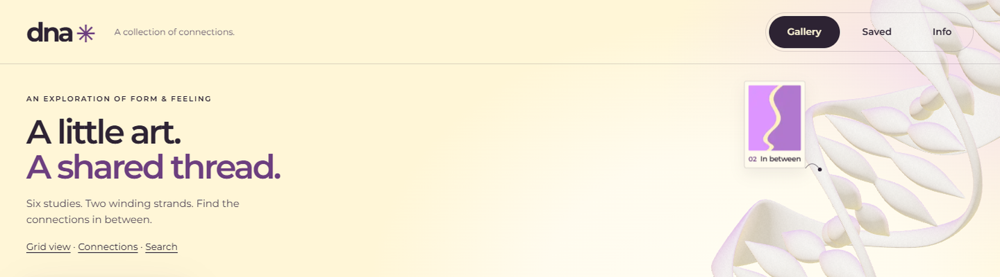
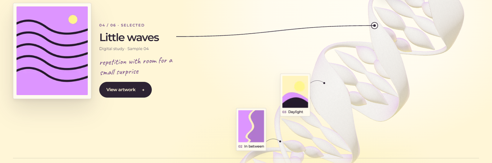
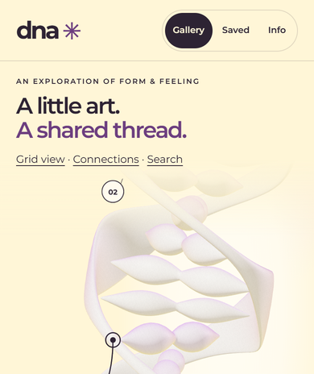

# DNA gallery — local MVP

A 3D DNA-helix gallery: six artworks on liquid-ribbon strands. Built with Next.js, React and three.js.

<p><a href="docs/screenshot-desktop.png"></a></p>
<p><a href="docs/screenshot-detail.png"></a> <a href="docs/screenshot-phone.png"></a></p>


## 3D DNA gallery (P2) — 18 November 2026

`/gallery` and `/helix` now show a true 3D double helix (three.js **0.187.0**, pinned). Scrolling moves the camera along the helix, half a turn per artwork. The nearest artwork becomes active 180 ms after scrolling stops. Previous/Next and the 01–06 picker fly the camera while focus stays on the pressed control, and a polite live region names the artwork. The active card opens `/artwork/<slug>?layout=helix` and Back returns to the same artwork. Pause motion (or OS reduced motion) holds a still pose. three.js is a separate chunk loaded only after a WebGL check, so Grid, Info, Connections, Saved and detail pages never download it.
- **Without WebGL:** the static gallery of six normal links shows.
- **Without JavaScript:** a `<noscript>` rule shows the same list, but see P2-QA.md: the app-wide `loading.tsx` currently hides all page content without JavaScript, which is a pre-existing issue.
- **Reverting:** the 2D traveling version (`traveling-dna.tsx`) is kept; swap one line in `gallery.tsx` to revert.
- **Code:** `helix3d-math.ts` and `helix3d-layout.ts` (pure, tested), `helix-gallery.tsx` (shell) and `helix3d-scene.tsx` with `helix3d.css` (scene).
- **Tests and checks:** 43 tests in `npm test`. Browser checks are in `qa-3d/p2_check.py`; results and screenshots are in `P2-QA.md` and `qa-3d/`. Design decisions: `design-p0/P1-DECISIONS.md`; prototype: `prototype-3d/`.
## Gallery and Info navigation

### Search and saved studies — 12 November 2026

Search from Gallery, Grid or Connections by title, description, color or graph topic. All search terms must match; combine the query with a Connections topic. Search, detail and related navigation preserve the query/filter return context. Empty results explain how to recover. Open `/saved` or the Saved navbar item for the browser-local shelf; Save study controls are beside Grid/Connections/related cards and on detail pages. No account or cloud sync. Storage denial uses memory until reload and explains that limit; JavaScript is required for saving. Current test runner includes 30 tests. See `DISCOVERY-FEATURES.md` for final identity, direct checks and limitations; older team reports are historical to their stated builds.

### Connections view — 11 November 2026

Open `/connections`, or choose Connections alongside DNA flow and Grid view. Shared color, form and theme concepts connect the six sample studies through a small evidence-bearing graph built from public captions and image descriptions. Artwork pages suggest related studies and expose the source excerpts under Why connected? Native filter URLs are shareable; detail and related-study navigation preserve the Connections return filter. No model service, database or dependency was added. See `GRAPH-ENGINEERING.md` for architecture, final build identity and verification scope. The test runners now include six graph tests, for 23 tests total. The latest evidence-precision update records each literal matched term alongside its source field and full quote, distinguishes singleton/universal topics, and labels the Connections heading as generated sample studies. Current integration identity and checks are in DNA-TEAM-INTEGRATION.md. Earlier identities below are historical.

The main navigation now links to `/gallery` (the enlarged traveling DNA gallery) and `/info` (collection information and browsing guidance), with an accessible current-page indicator. `/` opens `/gallery`. Existing `/helix`, `/grid` and artwork detail URLs continue to work. Info content describes the existing sample collection; no artist biography or contact details have been invented.

Navigation update production build: `cMiW20mhiyu1iLXIpllIK`, local server PID26672. Build and strict TypeScript passed. Browser-verified Gallery → Info → Gallery navigation and page titles/current indicators at768px; at320px both links have44px height, fit in the header, both pages have no horizontal overflow, and the Info return link opens the gallery with six artwork images. HTTP checks cover the home redirect and all gallery/info/legacy routes. Existing animation geometry was not changed by this navigation increment. Prior build/PID references below are historical; read `server.pid` and `.next/BUILD_ID` for current identity. No deployment or new dependency.

Two independently addressable gallery concepts use one content adapter. No layout has been selected for production. All imagery is original generated sample artwork; titles, captions and alternative text are fixtures. The current palette (site-navigation.css overrides the historical globals.css defaults) is cream #fff6d7, paper #fffbee, lavender #dda9ef, yellow #f8ed94 and ink #2d2333. The Plum topic swatch #594061 illustrates the metadata color category; it is separate from the interface ink. Montserrat and Caveat are provisional; licensed fonts are stored locally with their SIL Open Font Licenses.

## Run

Use Node 22.13+ and npm. From this directory:

```powershell
npm ci
npm run dev
```

Open http://127.0.0.1:3000. `/` is a comparison picker; `/helix` is the user's traveling-card DNA flow: each artwork moves down the curved strands, grows into the foreground, then recedes; `/grid` remains a conventional grid comparison. `/artwork/soft-orbit?layout=helix` demonstrates the detail route and return context.

On the current OpenBot host, Node exists outside PATH and npm is absent. Dependencies have already been installed. The included launcher uses that existing cached Node runtime without changing system settings:

```powershell
.\run-local.cmd dev
.\run-local.cmd build
.\run-local.cmd typecheck
.\run-local.cmd test
.\run-local.cmd start
.\run-local.cmd npm --version
.\run-local.cmd npm ls
```

`run-local.cmd npm <args>` runs the npm bundled with the same Node the launcher selects (PATH first, then the cached OpenBot runtime, then `%ProgramFiles%\nodejs`). It adds that Node folder to PATH for the one command only; no global or system settings change. Use it for P2 dependency work, e.g. `.\run-local.cmd npm install three`.

`start` requires a successful build first. Stop your foreground local server with Ctrl+C. A review server was started separately on loopback port 3000; see QA.md for its PID. If it is running, use its URL instead of starting a second instance on the same port. No deployment was made.

## Checks

```powershell
npm run build
npm run typecheck
npm test
```

The seventeen tests verify traveling-card/rung alignment, promotion, nonoverlapping projected hit areas, finite settling and directional following, alongside content integrity, current ladder selection/hysteresis/resize behavior, projected geometry and bounded paired-preview flow, plus the retained earlier trace component's math. Build checks all routes and TypeScript. Current evidence is in TRAVEL-QA.md; REFERENCE-INTEGRATION.md and LADDER-QA.md are historical; earlier increments are recorded in QA.md and MOTION-QA.md.

## Structure and behavior

- `src/content/gallery.ts`: async read-only adapter. Replace its implementation when content ownership and publishing are confirmed. A future backend must return only approved public records; this prototype supplies no authentication or authorization implementation.
- `src/components/gallery.tsx`: shared gallery with layout as a presentation parameter. No preferred DNA interpretation is stored in data.
- `src/components/artwork-link.tsx`: grid artwork navigation and history focus restoration. The 3D ladder owns its route/selection restoration; it records the artwork ID, scroll offset and numeric selection offset. Explicit return links target that artwork. Browser navigation remains functional when session storage is unavailable.
- `src/app/artwork/[slug]/page.tsx`: server-rendered, directly linkable artwork view; native link keyboard behavior, previous/next navigation and layout-aware return link. Unknown slugs render a 404. It uses full pages, not a modal.
- `src/app/globals.css`: shared responsive layout, visible focus and skip link. The grid/static gallery becomes one column on mobile; the interactive ladder keeps a large center and small side previews. Both layout controls remain available.
- `src/components/traveling-dna.tsx`, `traveling-dna.css`, `travel-math.ts`: current actual-card flow. Each artwork retains one image node and follows the same geometry as the two continuous SVG strands/rungs. Normal document scrolling drives position/depth/scale. At rest, a finite visual settle promotes the selected design without moving the document. The main uses contain fitting and zero yaw.
- `src/components/dna-ladder.tsx`, `dna-ladder.css`, `ladder-math.ts`: previous fixed-feature revision retained reversibly, not mounted. Shared selection/resize helpers remain reused.
- `src/components/helix-motion.tsx`, `helix-motion.css`, `helix-math.ts`: earlier tracing revision retained, not mounted. No animation framework or additional dependency was introduced.

### Traveling DNA controls

Scroll down/up to move the actual cards down/up along the two crossing paths. A narrow viewport window shows the main and nearby preceding/following designs; it does not show all six simultaneously. Activate a fully visible card or use Previous/Next and the fixed numbered picker to choose any design without scrolling. A separate View design link opens detail. Focus alone never selects or scrolls. When a focused traveling card leaves the safe viewport, focus transfers to its same-design numbered picker without scrolling, keeping it available instead of hiding focused content.

The user's supplied sketch guides this geometry; its annotation colors are not adopted. The earlier carousel reference informed restrained perspective, not copied choreography. The actual same image enlarges and recedes; there is no duplicate central hero image.

Pause DNA motion and system reduced motion show a complete static gallery with all six native detail links. Without JavaScript, the server-rendered static gallery remains available. Optional session storage holds only a pause boolean and validated artwork return state. No wheel interception, idle spin, network service or backend was added. Explicit detail/history/fragment restoration can position the page as part of navigation; animation never scrolls the document.

### Previous trace direction (retained source only)

On `/helix`, scroll down to trace both DNA strands and connecting rungs; scrolling up reverses the trace. A muted complete strand remains underneath. Motion affects only image interiors and shadows, leaving link hit areas and caption text stationary. All images remain visible, and keyboard-focused artwork is fully opaque and untransformed.

The **Scroll motion** button pauses to the complete static composition. This optional preference is stored as one boolean string in sessionStorage. With `prefers-reduced-motion: reduce`, the complete static strand and untransformed artwork are shown; the button explains that the system preference has disabled motion. Without JavaScript the complete SVG, artwork and native links remain available, and the inactive control is disabled. No timeline, scroll position or artwork content is persisted by the motion component.

The motion code never scrolls the page. The existing return helper honors explicit artwork fragments immediately and restores browser-history focus/position; those user-requested navigation operations are separate from animation.
- `public/samples/`: six original generated PNG fixtures, 1200×1500. Next Image serves responsive optimized derivatives. No third-party artwork or external image URLs are used.
- `src/fonts/`: self-hosted variable font files and licenses; no runtime font provider request.

The empty collection, loading, route-error and not-found presentations exist. Empty/error states are implementation paths and still need manual forced-state QA. Real images with mixed aspect ratios require further design review; the current fixtures are consistently 4:5; traveling and detail images use contain fitting.

## Decisions still needed

### Public content field mapping

The adapter returns only display metadata. IDs are stable sample identifiers independent of the route slug, and ordering is explicit and one-based. `listArtworks()` sorts by `sortOrder`. Fixtures remain visibly labeled samples. No rights evidence, permission contacts or private source/original paths are included.

| Content inventory | App field | Meaning |
| --- | --- | --- |
| `asset_id` | `id` | Stable identifier; current samples `sample-001` through `sample-006` |
| Route slug | `slug` | Unique URL-safe route name |
| `title` | `title` | Display title |
| `description` | `description` | Public caption/context, separate from image alt text |
| `alt_text` | `alt` | Accessible image description |
| `image_path` | `image` | Public display derivative path |
| `width_px`, `height_px` | `width`, `height` | Intrinsic image dimensions, positive integer pixels |
| `sort_order` | `sortOrder` | Stable one-based display order |
| Display medium / sample label | `medium` | Short public presentation label |

Publication state and inventory/rights workflow fields are intentionally deferred until ownership and publishing requirements are confirmed.

Final DNA interpretation and mobile treatment; typography and ink approval; actual assets and rights; captions/alt text and interface language; content ownership and editing/publishing workflow; public/private access; original-download policy. No admin, upload screen, fake authentication, Supabase integration, credentials or production release is included. Deployment requires a separate authorization and security review of the chosen workflow.

Dependencies are pinned in package.json and package-lock.json. Only Next.js, React, TypeScript and their type declarations were added. npm audit reported zero known vulnerabilities at installation; this is not a guarantee about future deployment safety.

## License

- The code is released under the MIT License (see [LICENSE](LICENSE)).
- The fonts in `src/fonts` keep their own SIL Open Font Licenses; the licence files sit next to them.
- The six sample images in `public/samples` are original generated sample artwork included for demonstration.
